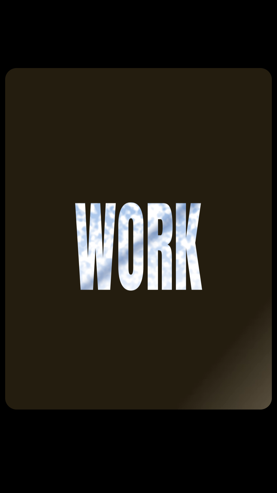
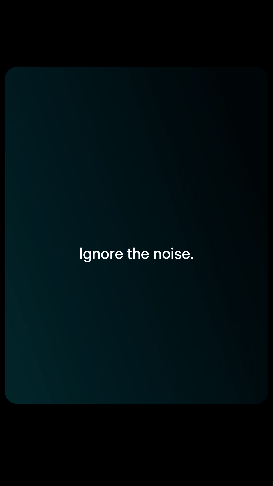

# Cinematic Card — editing style pack

A reusable pack for the **"cinematic card" motivational edit**: the style used in a lot of mindset/success shorts. This repo contains:

- **The full style spec**: every measurement, timing and rule, in [`docs/STYLE_GUIDE.md`](docs/STYLE_GUIDE.md)
- **Step-by-step recipes** for [CapCut](docs/capcut.md) and [Premiere Pro / After Effects](docs/premiere-aftereffects.md)
- **A B-roll shot list** for sourcing footage that fits: [`docs/broll-shotlist.md`](docs/broll-shotlist.md)
- **`presets/card_frame.png`**, a drop-in rounded-card overlay for CapCut/Premiere/Resolve
- **Bundled open-license fonts**: Inter Display for captions and Anton for the accent word
- **An automatic renderer** (`render.py`). Give it your clips and captions and it outputs a finished 9:16 video in this style.

| Accent word | Caption (settled) |
|---|---|
|  |  |

*(Previews use placeholder gradient footage from the demo.)*

## The style in 30 seconds

| Element | Rule |
|---|---|
| Frame | Footage sits in a **rounded 4:5 card** (1040×1330, radius 45) on **pure black**, slightly above center |
| Grade | Footage darkened about 30%, contrast +8%, saturation −10%. Moody and cinematic. |
| Cuts | **Hard cuts only**, every **~1.1s**, on phrase boundaries. Switch between the speaker and B-roll. |
| Captions | **2–4 words**, small white **Inter/Helvetica Medium about 62px**, centered at 52% height. **Blur + fade in over about 0.14s**, hard cut out. No stroke, no shadow, no box. |
| Caption timing | Captions are independent of video cuts and can carry across a cut |
| Accent word | **One power word per video** in huge condensed caps (Anton, stretched about 1.7× tall), **filled with a sky/chrome texture**. It pops in on the spoken word, holds about 0.5s, and hides the caption while on screen. |
| B-roll | Literal visualisations of the line (working on a laptop, a lone figure, cold/struggle, luxury/success) |

## Quick start (automatic renderer)

You need Python 3.8+, [Pillow](https://pypi.org/project/Pillow/) and [ffmpeg](https://ffmpeg.org/).

```bash
pip install pillow
```

```bash
bash scripts/make_demo.sh
```

The demo generates placeholder clips and writes `examples/demo.mp4`.

### Your own video

1. Copy `examples/demo.json` to `my_video.json`.
2. List your clips **in timeline order**. `start` is the in-point inside the source file and `duration` is how long it stays on screen.
3. Add captions with start/end times, or skip them and pass an SRT (CapCut auto-captions, Whisper and similar). Long lines are split into chunks of 4 words or fewer automatically. To chunk them yourself at natural phrase breaks (recommended for the final cut), add `"split_captions": false` to the project.
4. Add one accent word.
5. Set `"audio": "voiceover.mp3"` to use a separate voiceover. With `null`, the clips' own audio is used.

```bash
python3 render.py my_video.json -o my_video.mp4
```

```bash
python3 render.py my_video.json --srt captions.srt -o my_video.mp4
```

Preview a single frame without rendering the whole video:

```bash
python3 render.py my_video.json --still 3.1 -o preview.png
```

### Project file format

```json
{
  "fps": 30,
  "audio": "voiceover.mp3",
  "clips": [
    { "file": "media/me_talking.mp4", "start": 12.0, "duration": 1.4, "crop_y": 0.4 },
    { "file": "media/laptop.mp4",     "start": 0.0,  "duration": 1.0 }
  ],
  "captions": [
    { "text": "Listen",  "start": 0.0, "end": 0.7 },
    { "text": "for now", "start": 0.7, "end": 1.4 }
  ],
  "accents": [
    { "text": "work", "start": 2.0, "end": 2.4, "texture": "textures/fire.jpg" }
  ]
}
```

`texture` and `width` (target width in px, default 500) are optional per accent. It defaults to `textures/sky.png`. Generate a fresh one with `python3 scripts/make_texture.py`, or use any photo (clouds, chrome, light leaks, fire, gold).

Each caption can also take `"y"` (vertical center in px, to dodge on-screen text or logos) and `"shadow"` (0–1, soft dark glow for busy backgrounds).

`crop_y` (optional, 0 = top … 1 = bottom, default 0.5) sets which part of a tall clip shows inside the card.

### Customising the style

Every number lives in [`presets/style.json`](presets/style.json): card size and radius, dim amount, fonts, caption size and position, blur-in time and strength, accent width and stretch. Edit a copy and pass it with `--style my_style.json`.

## Dynamic variant (full-frame)

`presets/style_dynamic.json` drops the card. It uses bold captions in the lower third that pop in with a slight overshoot. Prices (and any `*word*` you mark) get a bigger line of their own, and a yellow highlight box follows the spoken word. The highlight is timed by spreading each caption across its words. For exact timing, add `"words": [[start, end], ...]` to a caption.

```bash
python3 render.py my_video.json --style presets/style_dynamic.json -o my_video.mp4
```

## Repo layout

```
render.py               automatic renderer (Pillow + ffmpeg)
presets/style.json      every style parameter
fonts/                  Inter Display + Anton (SIL OFL)
presets/card_frame.png  rounded-card overlay PNG for any editor
textures/sky.png        default accent-word fill
docs/                   style guide, editor recipes, B-roll shot list
examples/demo.json      sample project that mirrors the reference timing
scripts/                demo + texture generators
```

## License

Code and docs: MIT. Fonts: SIL Open Font License 1.1 (see `fonts/`).
